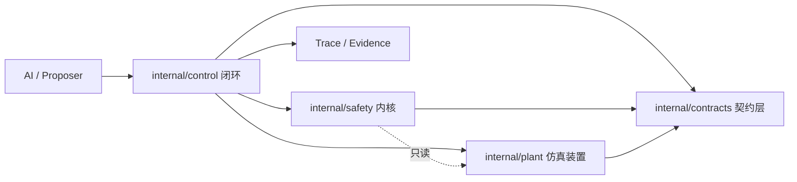

# HUSHFUSION Forge — 架构契约 v1（阶段 0）

> 状态：**阶段 0 冻结切片**（2026-10-21）。本文冻结的是**边界与职责**，不是能力声明。
> 配套：`docs/contracts/*.md`（五份核心契约）、`internal/contracts/`（Go 类型 + JSON Schema）。
> 诚实边界：本文描述的是**结构**，不是"已经做到的事"。任何"已实现"的表述以
> `docs/wiki/current-status.md` 与 `scripts/verify.sh` 的实测为准。

---

## 1. 目标与当前立场

**总目标**：把 Forge 从"可复现的静磁设计搜索系统"演进为
"以引力场/μ 为主物理路线、能自动发现可行装置设计、并最终支持多 Agent、多设备、
可拆装、可售卖、可安全控制真实设备的平台"。

**当前立场（必须如实）**：

| 事项 | 现状 |
|---|---|
| 物理 | 真空静磁学 + 上游闭式解门。**不回答"能不能聚变"** |
| 硬件 | **不存在**。本仓没有任何真实设备适配器 |
| AI | 只能**提议**；结构上无法自称完成（`internal/aios`） |
| 安全 | 本次新增 `internal/safety`：确定性、fail-closed、无 LLM/网络/时钟内部取时 |
| 闭环 | 本次新增 `internal/control`：仿真闭环已跑通并留痕 |
| G19 | **仍红**，红为设计所许。不得调阈值造绿 |

三条不可违反的原则（贯穿所有后续阶段）：

1. **引力场/μ 是主路线**，不得擅自改成 FRC 主路线。
2. **AI 只提议**；最终批准权属于 Safety Kernel。
3. **Safety Kernel 必须确定性、可审计、fail-closed**，且不依赖 LLM、网络或编排平面。

---

## 2. 目标架构（六平面）

```text
AI Plane            Provider / Agent / Planner / Memory
      ↓  (只提议 intent, 无权批准)
Bolloon Orchestration Plane
                   Agent / Device / Job / Lease / Channel
      ↓  (调度与隔离, 不做安全批准)
Governance Kernel   Task / Experiment / Design / Evidence / Permission
      ↓  (身份、谱系、证据、许可)
Safety Kernel       Limits / Interlock / State Machine / Command Validation
      ↓  (allow/deny, fail-closed)
Device Plane        Simulated Plant / Device Adapter / Sensor / Actuator
      ↓
Evidence Plane      Trace / Replay / Provenance / Audit / Reports
```

### 平面职责与禁止事项

| 平面 | 负责 | **禁止** |
|---|---|---|
| AI | 提出设计、实验、控制意图 | 直接控制设备、判定完成、改判据阈值 |
| Bolloon | Agent 生命周期、调度、通道、租约、多设备编排 | 物理真相、安全批准、实验完成判定 |
| Governance | 任务/实验/设计/证据/许可的谱系与一致性 | 越权批准 |
| Safety | 限幅、联锁、状态机、命令校验 | 依赖 LLM/网络；放过"没检查到" |
| Device | 传感器、执行器、状态机 | 自我扩权 |
| Evidence | 轨迹、回放、出处、审计 | 反向修改历史 run |

**依赖方向是单向的**：Evidence 只能被读，不能反向改写 Device；Safety 只能读 Device 状态，
不能写；AI 不能被 Device 依赖。




---

## 3. 五份核心契约

| 契约 | 文档 | Go 类型 | JSON Schema |
|---|---|---|---|
| 设计 | `docs/contracts/design.md` | `contracts.DesignCandidate` / `DesignVerdict` / `GateResult` | `schema/design-candidate.schema.json` / `design-verdict.schema.json` |
| 实验 | `docs/contracts/experiment.md` | `contracts.Experiment` | `schema/experiment.schema.json` |
| 设备 | `docs/contracts/device.md` | `contracts.DeviceState` | `schema/device-state.schema.json` |
| 控制命令 | `docs/contracts/control-command.md` | `contracts.ControlCommand` / `SafetyDecision` | `schema/control-command.schema.json` / `safety-decision.schema.json` |
| 证据 | `docs/contracts/evidence.md` | `contracts.EvidenceRef` / `control.Trace` | （引用型，无独立 schema） |

**契约版本**：`contracts.ContractVersion = "0.1"`。它与 `config.ForgeVersion`（判据版本）
**互相独立**：前者变 = 交换格式变了；后者变 = 同一个设计得了不同分数。

---

## 4. 控制闭环（本轮已实现）

```text
sensor state → AI proposal → Safety Kernel → actuator → plant update → evidence
```

三条纪律（由代码与单测强制）：

1. **AI 只提议**：Proposer 接口只返回 `ControlCommand` 意图。
2. **未经判决的命令不进装置**：只有 `allow` 才 `apply`；`deny` 一律留痕。
3. **AI 掉线 ⇒ 装置安全停机**：提议失败时闭环自合成 `safe_stop`，它走安全内核的
   **逃逸路径**（R11），因此断网时装置进入 `safe_stop`，不是保持上一条动作。

### Safety Kernel 判据表

| 规则 | 内容 | 失败含义 |
|---|---|---|
| R01 | 契约版本一致 | 交换格式错配 |
| R02 | 目标设备一致 | 发错设备 |
| R03 | 命令种类合法 | 未知命令 |
| R04 | 设备模式允许动作类命令 | 非法状态转换 |
| R05 | 状态新鲜 | 依据过期状态行动 |
| R06 | 命令新鲜 | 陈旧指令重放 |
| R07 | 命令序号严格递增 | 重复/乱序 |
| R08 | 执行器名已知 | AI 幻觉出执行器 |
| R09 | 执行器目标在限幅内 | 越限 |
| R10 | 单步变化率不超上限 | 突变 |
| R11 | 停机/关机走逃逸路径（任何模式允许） | —— |

`deny` 是**默认值**：任何无法判决的情况都落到 deny。停机命令**不受**模式与限幅约束，
否则"故障锁定"会退化成"锁死"。

---

## 5. 目标目录 ↔ 现有目录迁移表

| 目标目录 | 现有归属 | 本轮状态 | 迁移条件 |
|---|---|---|---|
| `internal/domain/design/` | `internal/design/` | **未动** | 判决层稳定后再谈 |
| `internal/domain/physics/` | `internal/physics/` | 未动 | — |
| `internal/domain/plasma/` `internal/domain/materials/` | — | **不存在** | 等有真实需求 |
| `internal/simulation/plant/` | `internal/plant/` | **已建**（名不同，内容已到位） | 重命名需同步 owners 名册 |
| `internal/simulation/sensors/` `internal/simulation/actuators/` | `internal/plant/` 内 | 未拆 | 需要独立驱动时拆 |
| `internal/simulation/scenarios/` | — | 不存在 | 场景库阶段 |
| `internal/control/state/` | `internal/control/` 内 | 未拆 | — |
| `internal/control/planner/` `internal/control/controller/` `internal/control/constraints/` | `internal/control/`（闭环）`internal/safety/`（约束） | 部分已到位 | 规划器阶段 |
| `internal/safety/kernel/` | `internal/safety/` | **已建** | — |
| `internal/safety/interlock/` `internal/safety/permissions/` `internal/safety/policies/` | — | 不存在 | 硬件接入前必须补 |
| `internal/orchestration/bolloon/` | `internal/kernelbridge/` `internal/bolloon/` | 未动 | — |
| `internal/orchestration/agents/` `devices/` `jobs/` | `internal/aios/`（部分） | 未动 | Bolloon 阶段 |
| `internal/intelligence/provider/` | `internal/ai/` | 未动 | — |
| `internal/intelligence/agents/` `memory/` `proposals/` | `internal/aios/` `internal/knowledge/` | 未动 | — |
| `internal/evidence/traces/` | `internal/control/`（Trace） | **已建**（在闭环内） | 证据平面独立时拆 |
| `internal/evidence/replay/` `provenance/` `gates/` | `scripts/`（门禁） | 未动 | — |
| `internal/contracts/` | — | **已建**（本轮） | — |

---

## 6. 阶段路线（与总计划一致，本轮只做阶段 0 + 最小切片）

| 阶段 | 内容 | 状态 |
|---|---|---|
| 0 | 架构契约（本文 + 五份契约 + 类型 + schema） | **本轮完成** |
| 1 | 拆薄 CLI / 应用层 | 未开始 |
| 2 | 统一设计判决漏斗（`DesignCandidate`→`DesignVerdict` 已就位，漏斗未接） | 未开始 |
| 3 | 仿真装置 + 闭环 | **本轮完成最小版**（占位模型） |
| 4 | Bolloon 多 Agent 编排 | 未开始 |
| 5 | AI 自动设计闭环 | 未开始 |
| 6 | 商品化模块系统 | 未开始 |
| 7 | 真实硬件适配 | 未开始（**没有硬件安全策略前禁止**） |

---

## 7. 验收与门禁

本轮的验收线：

- `gofmt` 干净、`go vet` 无意见、`go test ./...` 全绿；
- G4 所有权冻结门绿（新包已入册）；
- JSON Schema 与 Go 字段集合**双向**对齐（由单测盯住，防漂移）；
- 闭环测试覆盖：成功动作、越限拒绝、过期状态拒绝、AI 掉线 fail-closed、证据可重放；
- `docs/wiki/` 与 `docs/wiki/log.md` 已回写；
- **既有门禁无新增失败**，G19 保持红。

## 8. 本轮**没有**做到的事（诚实边界）

1. 没有接任何真实硬件，没有硬件安全策略、没有联锁、没有校准流程。
2. `internal/plant` 的传感器/执行器是**占位模型**，不是物理模型；它的读数**不可**用于
   任何物理结论。
3. `DesignVerdict` 的漏斗尚未接进 `internal/design` 的六道门；`Judge` 目前是独立可测组件。
4. 没有多 Agent 编排、没有 RL、没有模块化打包。
5. 契约 schema 校验器只支持一小撮 JSON Schema 关键字，且**遇到未知关键字直接报错**
   （不静默放过）。
6. 闭环轨迹只在内存中生成并可指纹化，尚未落盘到 `runs/` 或独立证据目录。

**迁移纪律**：不为目录好看搬迁。每一次搬迁都必须同步
`internal/owners/owners.go` 名册与 `CONTRACT.md` §2，且必须是一次可回滚的切片。
