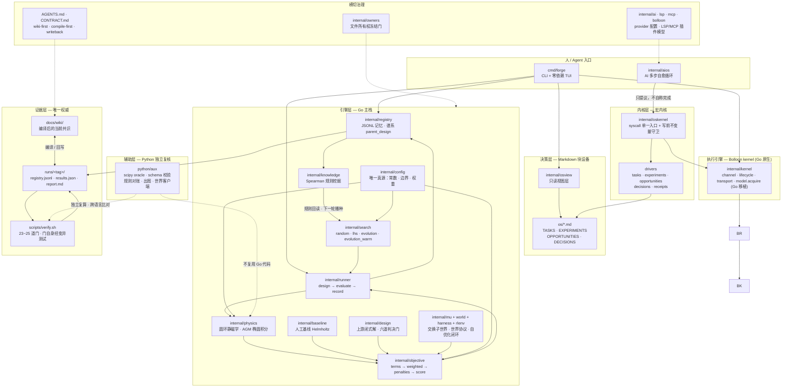

# HUSHFUSION Forge —— 架构图

> 一句话：**不是造一台装置，而是造一个能不断产生、验证、淘汰下一代装置设计的工程系统。**
> 本页是仓库架构的**单张总图**（2026-10-21 建）。细节口径见
> [wiki/project-overview.md](./wiki/project-overview.md)、[wiki/os-kernel-architecture.md](./wiki/os-kernel-architecture.md)、
> [wiki/os-operations.md](./wiki/os-operations.md)、[../CONTRACT.md](../CONTRACT.md)。

## 总图

## 读图三条主线

1. **写只有一条路。** 所有对决策层的写入都经 `internal/oskernel` 的 syscall 单一入口，先过写前不变量守卫
   （`active≤1`、`P=floor(I×E×R/C)`、ID 不重复、`E1` 不跳态），再落到 `os/*.md`（Markdown 块设备，git 背书）。
   `forge os` 与 `forge os tui` 只是这条路上的两个客户端。
2. **Agent 说完成 ≠ 完成。** `internal/aios` 里的 AI 只能**提议**（白名单：propose/add/new/advance），
   内核**没有** `active→done` 系统调用 —— 状态翻转只由 `os/tools/ossubmit --settle` 执行，
   它逐条勾验 acceptance 并校验 `runs/` 证据路径存在，否则 fail-closed。
3. **口径只有一处。** 所有物理常数、搜索边界、目标权重只在 `internal/config/config.go`；
   Python 侧从 `testdata/golden_spec.json` 读 spec，不抄默认值。Go 是主栈，Python 只做独立复核。

## 分层职责对照

| 层 | 目录 | 职责 | 权威性 |
|---|---|---|---|
| 决策层 | `os/` | 定义「做什么、凭什么算完成」：任务池 / 五态实验 / 机会池 / 决策日志 / 周复盘 | 与 `runs/`、`wiki` 冲突时以更具体者为准 |
| 内核层 | `internal/oskernel/` | syscall 分发 + 子系统驱动 + 写前守卫 | 进程内审计，不替代 `oscheck` 日门 |
| 执行引擎 | `internal/kernel/` | 串行 FIFO 执行、生命周期记录、模型租约（Bolloon kernel 的 Go 原生移植） | 只暴露机制，不判「该不该继续」 |
| 引擎层 | `internal/physics` `objective` `search` `runner` `registry` `knowledge` `design` `mu` `rlenv` `harness` `world` | 设计 → 评分 → 记录 → 学习闭环 | 分数可位级回算（`internal/objective`） |
| 辅助层 | `python/aux/` | 独立 scipy oracle、schema 校验、规则对账、出图、世界客户端 | **不 import 任何 Go 代码**（G8/G10 的前提） |
| 证据层 | `runs/<tag>/` `scripts/verify.sh` `docs/wiki/` | 唯一权威：原始记录 + 门禁 + 当前共识 | SKIP ≠ 通过；红门就是红 |
| 治理 | `internal/owners/` `AGENTS.md` `CONTRACT.md` | 所有权冻结门（变异会红）、wiki-first 范式、写回纪律 | 合同变更须同 commit 同步 CONTRACT.md |

## 门禁分工速查（`bash scripts/verify.sh phase1`）

| 门 | 抓什么失败模式 |
|---|---|
| G1–G3 | 能不能编译 / 静态分析 / 格式化契约 |
| G4 | 所有权名册重叠或遗漏（门自身经变异测试） |
| G5–G7 | 解析锚点 / 基线在搜索盒内 / RL 不得假装有学到的策略 |
| G8–G10 | Python oracle 对 golden / CLI 端到端 / 跨语言场一致性 (<1e-9) |
| G11–G16 | 注册表完整性 / schema 一致 / 辅助层自测 / 规则对账 / 出图复评 / 逐位复现 |
| G17–G22 | 上游设计锚点 / 世界协议 v1·v2 / 世界结构（G19 红为设计所许）/ 交换子世界 |
| G23–G25 | 可造性 / Bolloon kernel bridge 七条 / OS↔kernel 双向端到端 |

## 诚实边界

- 图是**结构图**，不是能力声明：每条线只表示「接口在哪、权威在哪」，不表示该线已经跑通。
- 引擎层是**真空静磁**（Biot–Savart）域：没有等离子体、没有平衡、没有有限 β、没有涡流 ——
  它回答「这个线圈配置的场结构好不好」，**不回答**「这台装置能不能聚变」。
- `internal/rlenv` 至今**无策略**（G7 反造假门），`internal/harness` 的 OML 层依赖外部
  `torch/hibs_lnn`，缺失时 fail-closed 回退到规则层。
- `internal/aios` 的自愈只在「提议 → 内核」回路内，**无跨轮记忆、无跨会话记忆**。
- `bridge/` 的 kernel actor 状态**只存在于进程内**，跨进程核对历史要读 `os/evidence/` 落盘文件。
- `headless`（SSM + OML 持续学习）目前只**留槽位**（`model.acquire` 租约），不实现（T-08）。

## 相关

- [wiki/index.md](./wiki/index.md) —— wiki 索引
- [wiki/project-overview.md](./wiki/project-overview.md) —— 项目概览
- [wiki/os-kernel-architecture.md](./wiki/os-kernel-architecture.md) —— 宏内核 syscall 面
- [wiki/os-operations.md](./wiki/os-operations.md) —— 决策层操作与 CLI/TUI
- [../CONTRACT.md](../CONTRACT.md) —— 所有权名册、纪律、数值锚点
- [../README.md](../README.md) —— 项目总述与 Phase 0 实测
